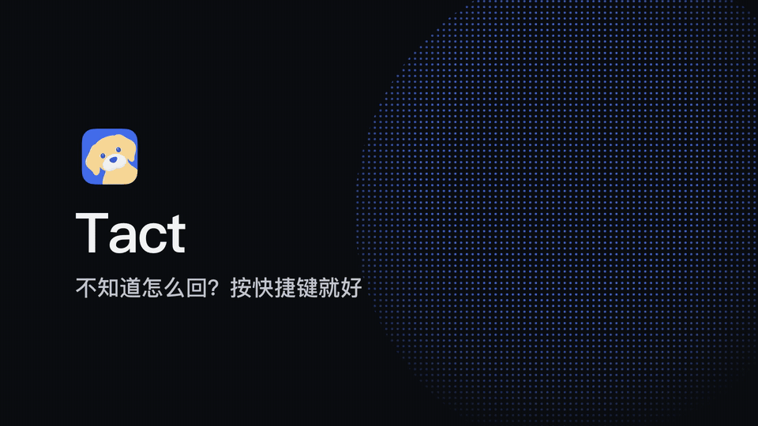
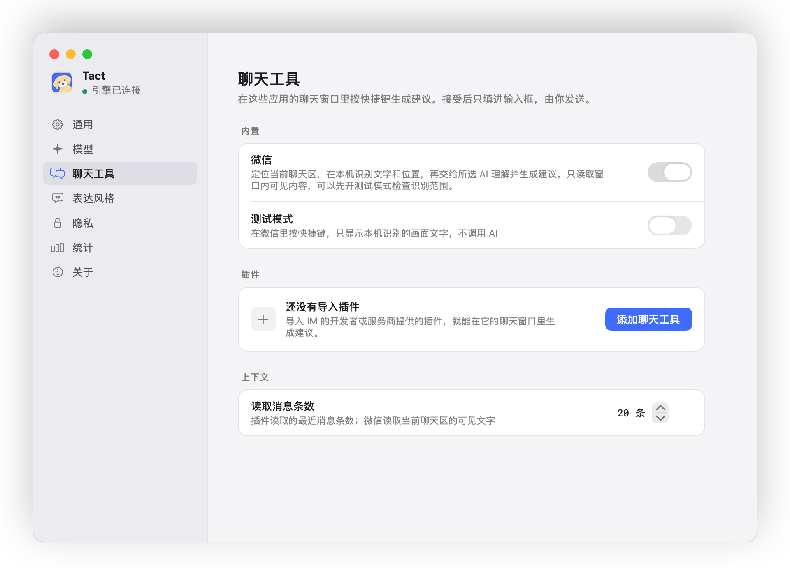
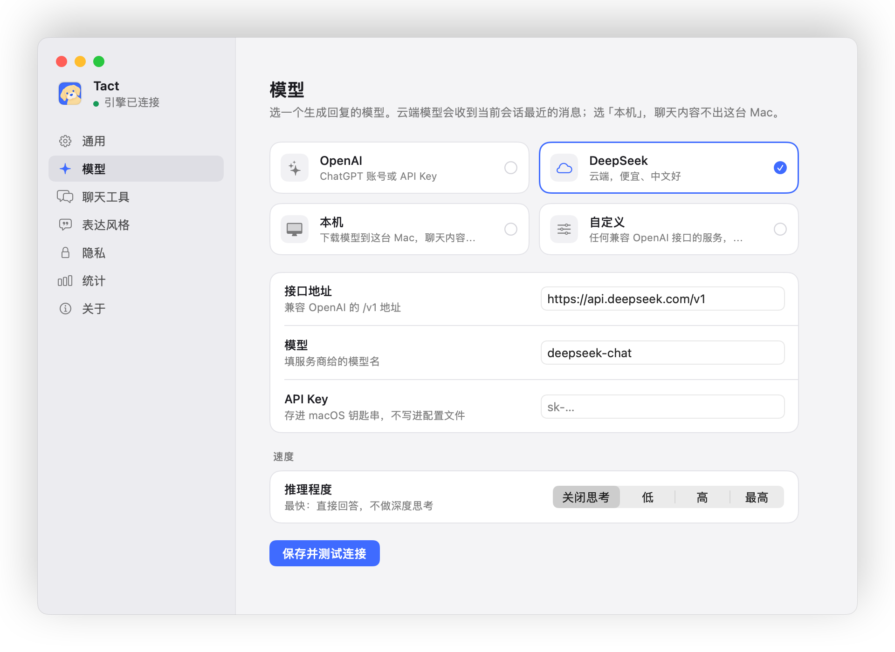
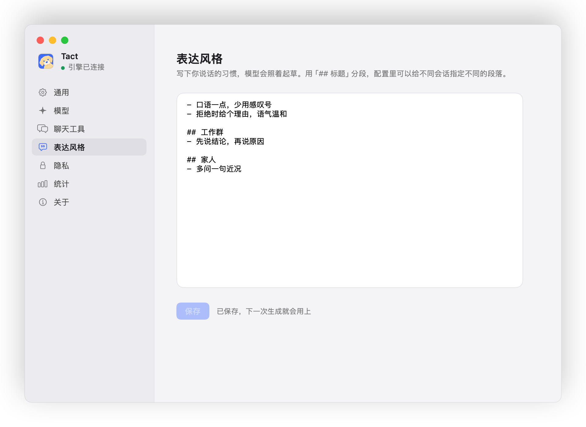

<div align="center">


# Tact

### 不知道怎么回？按快捷键就好

**在聊天窗口里按快捷键，Tact 读完最近的聊天，把一句合适的回复放进输入框。**<br>
按 Tab 采用；发不发、怎么改，都由你。

[](LICENSE)  

**[下载](https://github.com/wyh0626/tact/releases/latest)** &nbsp;·&nbsp; **[使用说明](docs/GUIDE.md)** &nbsp;·&nbsp; **[接入新的聊天工具](docs/ADAPTER.md)**

[English](README.en.md)

<br>


</div>

<br>

## 适合你吗？

消息一多，回复就成了体力活：翻上下文、想措辞、打字、再改。Tact 把它缩成两个按键：

- **输入框空着**：按快捷键，结合最近的聊天给出一句你最可能要发的话，以灰字显示，按 Tab 填入。
- **打了几个字**：比如「拒绝」「下周再说」，Tact 当作你的意思，扩写成一句得体的话；写好的长草稿只修语句和语气，不改立场。
- **没有合适的**：提示「这次不建议」，不硬凑。

它**从不替你发送**，只把字放进输入框。如果你回消息本来就快，或者不想让 AI 碰聊天内容，就不需要它。

## 演示



<sub>输入框空着时按快捷键出灰字，按 Tab 采用；打「拒绝」再按快捷键，改写成得体的话。</sub>

## 快速开始

**1 · 安装。** 从 [Releases](https://github.com/wyh0626/tact/releases/latest) 下载 `Tact-版本号-arm64.dmg`，把 Tact 拖进「应用程序」。打开后它只在菜单栏显示一只小狗，没有主窗口。

<sub>需要 macOS 14 及以上、Apple Silicon。安装包经过苹果公证，双击就能打开。以后有新版本，Tact 会在菜单栏提示，点一下就装好。</sub>

**2 · 跟着引导走。** 打开辅助功能和屏幕录制权限，选一个模型，再在「试一试」里拿一段模拟聊天练一遍。快捷键可以在设置里换成你顺手的。

界面支持简体中文和英文，默认跟随系统。可以在欢迎页或「设置 → 通用 → 语言」里切换，立即生效。界面语言不改变已有的表达风格或回复语言偏好。

**3 · 接入聊天工具。** 微信在「聊天工具」里打开开关就能用；其他 IM 导入它的插件。之后在聊天窗口里按快捷键。

## 接入聊天工具

<picture>
  <source media="(prefers-color-scheme: dark)" srcset="docs/images/settings-chat-dark.png">
  
</picture>

| 聊天工具 | 怎么接入 | 状态 |
| --- | --- | --- |
| 微信 | 内置。在本机截图识别当前聊天和输入框，不读数据库，不改动微信 | 可用 |
| 钉钉 | 内置。通过辅助功能读取当前会话、消息和输入框，读不到时改为截图识别；不需要管理员开通任何权限 | 可用 |
| Telegram | 插件。扫码登录，用官方 API 只读最近的消息 | 实验性 |
| 其他 IM | 按[插件规范](docs/ADAPTER.md)写一个插件，拖进「添加聊天工具」 | — |

## 模型

<picture>
  <source media="(prefers-color-scheme: dark)" srcset="docs/images/settings-model-dark.png">
  
</picture>

- **ChatGPT 账号**：用 Plus / Pro 套餐的额度，不需要 API Key。
- **云端服务**：预设 OpenAI、DeepSeek、Claude、Gemini、智谱、Kimi、通义千问、豆包、硅基流动、OpenRouter 和 MiniMax。填好地址和 Key 后读取模型列表，下拉选择或手动填写模型 ID；Key 按连接存入 macOS 钥匙串。
- **自定义接口**：明确选择 OpenAI Chat Completions、OpenAI Responses、Claude Messages 或 Gemini 协议；服务商专用参数和请求头放在「高级设置」。
- **推理控制**：优先采用模型接口返回的能力，缺少的字段用服务商的通用档位补充，不按模型名猜测；模型 ID 可以手动填写，模型不接受的参数会自动去掉。普通保存保留手写参数；输出上限和超时可在高级设置调整。
- **本机**：内置 llama.cpp，在设置里下载一个 Qwen3 模型，聊天内容不出这台 Mac。

## 照你的说话方式写

<picture>
  <source media="(prefers-color-scheme: dark)" srcset="docs/images/settings-style-dark.png">
  
</picture>

用几行字写下你的说话习惯，比如「少用感叹号」「拒绝时给个理由」。用「## 标题」分段，工作群和家人可以各用一套。

## 隐私

- 截图只在本机内存里识别，不保存，不上传。
- 发给模型的只有会话名、最近的聊天文字、你的草稿和表达风格；用本机模型时这些都不出这台 Mac。
- 统计只记次数、长度和耗时，不记聊天文字。
- 检查更新只访问 GitHub，请求里只有 Tact 的版本号；可以在「设置 → 关于」里关掉自动检查。

## 从源码构建

需要 Go 1.24 和 Xcode 命令行工具。

```bash
./scripts/setup.sh        # 编译引擎和应用，生成 ~/.tact 下的配置
./scripts/test.sh         # 全部测试
TACT_SIGN_IDENTITY=- ./scripts/build-app.sh && ./scripts/build-dmg.sh   # 打包可分发的 DMG
```

配置项、插件、排错等细节见[使用说明](docs/GUIDE.md)。演示动画用 [HyperFrames](https://github.com/heygen-com/hyperframes) 制作，源文件在 [docs/demo](docs/demo)。

## 许可证

[MIT](LICENSE)。内置的 [llama.cpp](https://github.com/ggml-org/llama.cpp)、负责更新的 [Sparkle](https://github.com/sparkle-project/Sparkle) 和 Telegram 插件依赖的 [gotd](https://github.com/gotd/td) 也都是 MIT。
